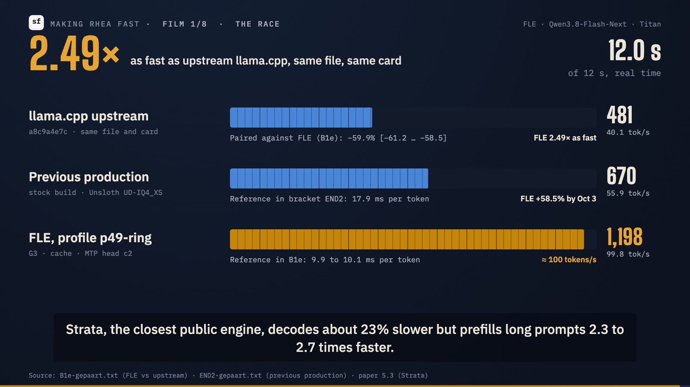
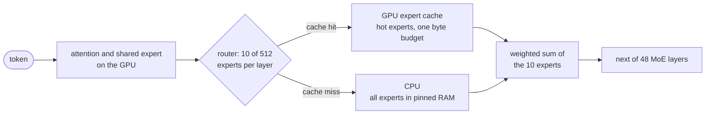
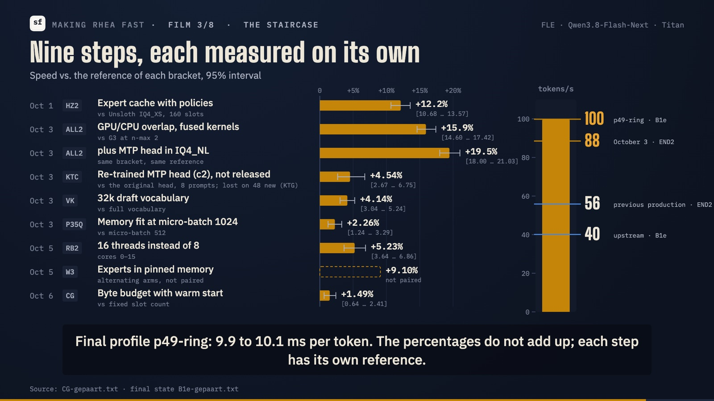

<div align="center">

# FLE · Fast Local Experts

**An 89 GB Mixture-of-Experts model at ~90 tokens/s on one 32 GB GPU.**

A [llama.cpp](https://github.com/ggml-org/llama.cpp) fork for running large MoE GGUF models locally (local LLM
inference) that keeps the hot experts of a large MoE model in a GPU
cache, computes the rest on the CPU, and drafts with the model's own multi-token-prediction head.

[Technical report](https://sirfyyn.github.io/FastLocalExperts/) ·
[PDF](https://sirfyyn.github.io/FastLocalExperts/fle-paper.pdf) ·
[Model files](https://huggingface.co/sirfyyn/Qwen3.8-Flash-Next-FLE-GGUF) ·
[Quick start](#quick-start) ·
[Films](#making-rhea-fast-eight-short-films) ·
[Website](https://sirfyyn.de/en/fle/) ·
[FLE Link](https://flelink.run) ·
[YouTube](https://www.youtube.com/@sirfyyn)

[](https://doi.org/10.5281/zenodo.23272400)
[](https://github.com/sirfyyn/FastLocalExperts/releases)
[](LICENSE)
[](https://huggingface.co/sirfyyn/Qwen3.8-Flash-Next-FLE-GGUF)

<a href="https://huggingface.co/sirfyyn/Qwen3.8-Flash-Next-FLE-GGUF/resolve/main/media/making-rhea-fast-1.mp4"></a>

<sub>Film 1 of 8, <i>The race</i>: upstream llama.cpp, our previous setup and FLE decode side by side (click to play, 0:33).</sub>

</div>

## What FLE is

Large Mixture-of-Experts models use only a few experts per token. Qwen3.8-Flash-Next picks 10 of 512 experts in each of
its 48 MoE layers, so most of its weights are idle at any moment. FLE splits the model along that line: attention, the
shared weights, the KV cache and a cache of hot experts live on the GPU; the bulk of the routed experts stays in system
RAM and is computed on the CPU when it is not cached.

FLE was built and measured for one model on one machine: Qwen3.8-Flash-Next as the 88.87 GB FLE-IQ3_M file on a
workstation with one 32 GB GPU and 120 GB of RAM. It is not a general system. The
[technical report](https://sirfyyn.github.io/FastLocalExperts/) is a measured account of what worked, what did not, and
by how much, written so that someone with similar hardware can reproduce it.

## Results

| Comparison | Result | Source |
|---|---|---|
| **Decode against upstream llama.cpp** (`a8c9a4e7c`, newer than FLE's base): same file, same GPU, same 16 threads | **2.49× as fast** (upstream −59.9 % [95 % CI −61.2 .. −58.5]); 2.78× against upstream with `-ub 4096` | bracket B1e, [report 5.1](https://sirfyyn.github.io/FastLocalExperts/#s5-1) |
| **Decode against our previous production** (stock llama.cpp with Unsloth UD-IQ4_XS, about 56 tokens/s) | **+58.5 %** [+55.8 .. +61.6], measured before the last steps | bracket END2, [report 5.2](https://sirfyyn.github.io/FastLocalExperts/#s5-2) |
| **Decode against [Strata](https://github.com/Niko1221/strata)**, the closest public engine | **23 % faster**: 91.2 against 74.0 tokens/s on six tasks (medians of separate runs, not paired) | [report 5.3](https://sirfyyn.github.io/FastLocalExperts/#s5-3) |
| **Prefill** | **FLE is slower**: upstream with `-ub 4096` processes 4k and 8.6k prompts 24 % and 12 % faster, Strata 2.3 to 2.7 times as fast. Prefill is the next work item | [report 5.1](https://sirfyyn.github.io/FastLocalExperts/#s5-1), [5.3](https://sirfyyn.github.io/FastLocalExperts/#s5-3) |
| **Quality** of FLE-IQ3_M | KL divergence against BF16 within the noise of Unsloth UD-IQ4_XS on three texts, at 4.8 GB less | [report 3](https://sirfyyn.github.io/FastLocalExperts/#s3) |
| **Benchmarks**, one run each | IFBench 80.3 / 83.0 (strict / loose) and GPQA Diamond 88.9: level with Qwen's card (81.3, 91.7). LiveCodeBench v6 85.5: below the card (91.9) | [report 5.4](https://sirfyyn.github.io/FastLocalExperts/#s5-4) |

Hardware: AMD Ryzen 9 9950X3D (16 cores), 120 GB DDR5, one NVIDIA RTX PRO 4500 Blackwell (32 GB), Linux. FLE decodes at
about 100 tokens/s on the 24 prompts of bracket B1e and at 91 tokens/s on the six tasks of the Strata comparison; the
report's title says ~90.

Every speed claim except the Strata comparison comes from a paired bracket: a reference run, the candidate runs, the
reference again, the same prompts, at most 5 % drift between the two reference runs, and 95 % bootstrap intervals over
the paired requests ([report 2.4](https://sirfyyn.github.io/FastLocalExperts/#s2-4)). The speed series used an internal re-trained MTP head
(c2). The published head is the untrained one: on 16 unseen tasks it was +2.95 % [+1.96 .. +3.93] faster than c2, and
the series was not re-run with it.

## How it works



Cache hits and misses are computed at the same time. After the last layer, the model's own MTP head drafts two more
tokens, and the main model checks them in its next pass (speculative decoding).

- **GPU expert cache.** Hot experts are cached in VRAM. One byte budget (`FLE_MOE_CACHE_BUDGET_MIB`) sizes the cache
  for all layers; experts are admitted by request frequency and evicted among the oldest slots. A usage profile
  (`FLE_MOE_PROFILE`), written while the server runs, fills the cache at the next start.
- **Overlap.** Cache hits run on the GPU while the misses run on the CPU (`FLE_MC_OVERLAP`), with fused CUDA kernels.
- **MTP speculative decoding.** The model's own multi-token-prediction head, a separate 1.53 GB file with its experts
  requantized to IQ4_NL, drafts two tokens per step (`--spec-type draft-mtp -md`). A 32k draft vocabulary
  (`FLE_MTP_VOCAB`) makes drafting cheaper.
- **Pinned expert loading.** `--load-mode none` reads the expert weights once into pinned host memory for fast copies
  to the GPU.
- **Prefill that borrows the cache.** With `FLE_UBATCH_LEND`, decode runs with a 1,024-token batch, and a prompt of
  2,048 tokens or more borrows expert-cache layers for a 4,096-token batch and gives them back afterwards. `FLE_PREFILL_LEAN` lowers the peak
  memory of long prefills.
- **AVX2 kernel for `Q2_0`.** Upstream computes `Q2_0` only with a scalar kernel on x86; FLE-IQ3_XXS and FLE-IQ2_M
  need the fast one.
- Also: early slot save for the server prompt cache (`FLE_SLOT_EARLY_SAVE`), the trellis types `IQ2_KT`/`IQ3_KT`/
  `IQ4_KT` from ik_llama.cpp, and a CUDA hybrid pager path after FreeToken.

All FLE features are opt-in. With none of them set, FLE behaves like the llama.cpp it is based on. Every variable and
flag is listed in [docs/fle/ENV.md](docs/fle/ENV.md); how each part works and what it gained is in
[report 4](https://sirfyyn.github.io/FastLocalExperts/#s4).

### Nine steps, each measured on its own

<p align="center"><a href="https://huggingface.co/sirfyyn/Qwen3.8-Flash-Next-FLE-GGUF/resolve/main/media/making-rhea-fast-3.mp4"></a></p>

Each step was measured against the engine state before it, so the percentages do not add up. What did not work is in
the report as well: expert prefetching by pre-gating, n-gram drafting, low-rank kernels, fully self-made quantizations,
copying cache misses over PCIe and a rebase onto current upstream all lost
([report 6](https://sirfyyn.github.io/FastLocalExperts/#s6)).

## Quick start

As tested: Linux with CUDA, one NVIDIA GPU with 32 GB, a CPU with AVX2 and 120 GB of RAM (we have not tested how much
less is enough). The download below is 90.4 GB.

**1. Build.** FLE builds like llama.cpp ([docs/build.md](docs/build.md)):

```bash
git clone https://github.com/sirfyyn/FastLocalExperts
cd FastLocalExperts
# CUDA architecture: 89 for Ada, 120 for Blackwell
cmake -B build -DGGML_CUDA=ON -DCMAKE_BUILD_TYPE=Release -DCMAKE_CUDA_ARCHITECTURES=120
cmake --build build --config Release -j
```

The tags [`v1.0`](https://github.com/sirfyyn/FastLocalExperts/tree/v1.0) and
[`v1.0.1`](https://github.com/sirfyyn/FastLocalExperts/tree/v1.0.1) carry the same engine code: the measured state plus
two fixes that do not change the computation (a slot fix for concurrent requests and a crash report).

**2. Download** FLE-IQ3_M and the MTP head with the [`hf` CLI](https://huggingface.co/docs/huggingface_hub/guides/cli):

```bash
hf download sirfyyn/Qwen3.8-Flash-Next-FLE-GGUF --include "IQ3_M/*" --include "mtp/*" --local-dir models
```

**3. Run.** This is the configuration of all speed numbers above (32 GB card, a 262,144-token context shared by two
slots):

```bash
FLE_MOE_CACHE_BUDGET_MIB=17035 FLE_MOE_CACHE_BUDGET_FIT=1 \
FLE_MOE_PROFILE=models/expert-profile.bin FLE_MOE_PROFILE_SAVE_SEC=600 \
FLE_MOE_ADMIT_FREQ=2000 FLE_MOE_EVICT_OLDEST=32 FLE_MOE_CACHE_BIAS=0.001 FLE_MOE_OBS_MAXTOK=8 \
FLE_MC_OVERLAP=2 FLE_HC_FUSED=1 FLE_CKPT_TAIL=512 \
FLE_MTP_VOCAB=models/mtp/fle-mtp-vocab-32k.txt FLE_MTP_VOCAB_N=32768 FLE_MTP_PENALTIES=1 \
FLE_PREFILL_LEAN=1 FLE_SLOT_EARLY_SAVE=1 FLE_CACHE_GUARD_SLOT=0 \
FLE_UBATCH_LEND=1 FLE_UBATCH_PREFETCH=1 FLE_UBATCH_PREFETCH_SLOTS=3 \
./build/bin/llama-server \
  -m models/IQ3_M/Qwen3.8-Flash-Next-FLE-IQ3_M-00001-of-00002.gguf \
  -md models/mtp/mtp-Qwen3.8-Flash-Next-FLE-IQ4_NL.gguf \
  --spec-type draft-mtp --spec-draft-n-max 2 --spec-draft-p-min 0.5 --no-spec-draft-backend-sampling \
  -cmoed -c 262144 --parallel 2 --kv-unified --jinja \
  -b 4096 -ub 4096 -ctk q8_0 -ctv q8_0 \
  -fit on --fit-target 1115 --moe-expert-cache-inserts 1 \
  --cache-ram 32768 --load-mode none -t 16 -C 0x0000FFFF --cpu-strict 1 \
  --temp 0.6 --top-p 0.95 --top-k 20 --min-p 0 --presence-penalty 1.5
```

The server then listens on <http://127.0.0.1:8080> with llama.cpp's web UI and its OpenAI-compatible API
(`/v1/chat/completions`).

What to adapt:

- `-t 16 -C 0x0000FFFF --cpu-strict 1` runs one thread per physical core, pinned to cores 0-15. Use your own core count
  and mask.
- `FLE_MOE_CACHE_BUDGET_MIB` and `--fit-target` are tuned for a 32 GB card with this context. How the budget,
  `--fit-target` and `--moe-expert-cache` interact is in [docs/fle/ENV.md](docs/fle/ENV.md); other cards are untested.
- `--load-mode none` pins the expert weights in RAM (52.2 GiB for FLE-IQ3_M) where the page cache cannot reclaim them.
  Leave it out if RAM is tight; prefill and decode were slower without it in our test.
- FLE-IQ3_XXS and FLE-IQ2_M run with the same flags and the same budget. Without MTP, leave out `-md` and the `--spec-*`
  flags.
- The sampling flags are Qwen's recommended settings for thinking mode. What every flag does, with the measurements
  behind it, is on the [model card](https://huggingface.co/sirfyyn/Qwen3.8-Flash-Next-FLE-GGUF#running).

Memory, measured with this command: FLE-IQ3_M takes 54.3 GiB of system RAM (52.2 GiB of it pinned) and fills the GPU by
design (31,315 MiB); loading took 167 s from an NFS share. On top come the prompt cache (`--cache-ram 32768`, up to
32 GiB) and the page cache for the 26.8 GiB per-layer token table, which stays memory-mapped from the file.

The FLE model files are standard GGUF and also load in upstream llama.cpp, for example
`llama-server -m <file> -cmoe -ngl 99 -c 32768 --jinja`, without the MTP head. With the same file, FLE decoded 2.49
times as fast as upstream in bracket B1e.

### FLE Link: run it without a command line

[FLE Link](https://github.com/sirfyyn/flelink) is the layer between an inference engine and the tools that use it. It is one
file (`flelink`) for macOS, Linux and Windows that looks at the machine, installs the engine that fits (FLE or plain
llama.cpp), downloads a model that fits and checks it against its SHA-256, chooses the start settings, and serves an
OpenAI-compatible API with a browser interface beside it: a chat with the live numbers (decode and prefill speed, MTP drafts
accepted, expert-cache hits, GPU use), launch profiles that show the full command before it runs, and a short repeatable
speed test. It can also attach to a llama-server that already runs, also as a systemd service. This repository is the
engine only; FLE Link and the engine can be replaced independently.

<a href="https://github.com/sirfyyn/fle-studio/blob/main/docs/media/fle-studio.mp4"></a>

<picture>
  <source media="(prefers-color-scheme: dark)" srcset="https://raw.githubusercontent.com/sirfyyn/fle-studio/main/docs/media/engine-dark.png">
  
</picture>

Recorded on the reference machine against the running service. The speeds in the recording are single answers right
after a restart, not measurements; the measured numbers are in [Results](#results).

## Model files

All on Hugging Face in [sirfyyn/Qwen3.8-Flash-Next-FLE-GGUF](https://huggingface.co/sirfyyn/Qwen3.8-Flash-Next-FLE-GGUF);
the pruned file has its own repo,
[sirfyyn/Qwen3.8-Flash-Next-FLE-REAP448-GGUF](https://huggingface.co/sirfyyn/Qwen3.8-Flash-Next-FLE-REAP448-GGUF). The
hybrids are splices of public quantizations by [Unsloth](https://unsloth.ai) and
[ISTA-DASLab](https://huggingface.co/ISTA-DASLab): whole expert layers, chosen layer by layer by measured sensitivity,
copied byte for byte.

A dense 27B model that runs on this engine: [Katy](https://huggingface.co/sirfyyn/Katy-27B-GGUF), IQ4_XS, 15.3 GB, with a DFlash2 draft head. Details and measurements: https://sirfyyn.de/en/katy/

| File | Size | KLD vs BF16 (texts E / W / K) | Decode vs FLE-IQ3_M on FLE | In one line |
|---|---|---|---|---|
| **FLE-IQ3_M** | 88.87&nbsp;GB | 0.051 / 0.050 / 0.129 | reference | within the noise of Unsloth UD-IQ4_XS (93.7 GB: 0.049 / 0.046 / 0.122) |
| **FLE-IQ3_XXS** | 79.48&nbsp;GB | 0.090 / 0.093 / 0.227 | −0.7 % [−2.1 .. +0.6] | the KLD of Unsloth UD-IQ3_XXS (82.0 GB) at 2.5 GB less |
| **FLE-IQ2_M** | 71.62&nbsp;GB | 0.160 / 0.163 / 0.339 | +11.6 % [+9.8 .. +13.4] | clearly below the larger Unsloth UD-IQ1_M (74.5 GB) |
| **FLE-IQ3_M-REAP448** | 82.00&nbsp;GB | 0.080 / 0.086 / 0.185 | +0.7 % [−0.3 .. +1.8] | FLE-IQ3_M with 64 of 512 experts per layer pruned by REAP saliency |
| **MTP head** | 1.53&nbsp;GB | – | – | the model's own MTP module, experts requantized to IQ4_NL; needs FLE |

KLD is the mean KL divergence of the next-token distribution against BF16, measured with upstream `llama-perplexity` on
three public texts (lower is better; compare within a column). KLD on a few texts understates what pruning removes; the
400-question knowledge probe is on the model card. Decode is from the paired brackets B3e1 to B3e6, with one cache
budget for every file. The model files are derivatives of Qwen3.8-Flash-Next under the Qwen Community License 1.0; all
measurements behind this table are on the [model card](https://huggingface.co/sirfyyn/Qwen3.8-Flash-Next-FLE-GGUF).

## Tools and documentation

- [`tools/fle-kernel-bench/`](tools/fle-kernel-bench/), [`tools/fle-step-bench/`](tools/fle-step-bench/): kernel and decode-step measurement tools (with `llama-bench`, `llama-perplexity`, `llama-batched-bench`).
- [`docs/fle/ENV.md`](docs/fle/ENV.md): every `FLE_*` variable and every flag the fork adds.
- [`docs/fle/fle-paper-v1.0.1.pdf`](docs/fle/fle-paper-v1.0.1.pdf): the technical report as archived with `v1.0.1`.

## Making Rhea fast: eight short films

Eight short films (English, subtitles burned in, 33 to 63 s each, 7 min in total) show how FLE was measured on one
machine and what did and did not work. Rhea is the name of the model on that machine. Every number in the films comes
from the measurement database behind the report (6,130 measurements, state of 2026-10-08); where a film and the report
differ, the report is the reference. GitHub does not play videos from repository files, so the posters link to the
films on Hugging Face. All eight are also on YouTube as one playlist:
<https://www.youtube.com/playlist?list=PLMYhpsBSEhIQ>.

<table>
<tr>
<td width="25%"><a href="https://huggingface.co/sirfyyn/Qwen3.8-Flash-Next-FLE-GGUF/resolve/main/media/making-rhea-fast-1.mp4"></a><br><b>1 · The race</b> (0:33)</td>
<td width="25%"><a href="https://huggingface.co/sirfyyn/Qwen3.8-Flash-Next-FLE-GGUF/resolve/main/media/making-rhea-fast-2.mp4"></a><br><b>2 · The bracket</b> (0:34)</td>
<td width="25%"><a href="https://huggingface.co/sirfyyn/Qwen3.8-Flash-Next-FLE-GGUF/resolve/main/media/making-rhea-fast-3.mp4"></a><br><b>3 · The staircase</b> (1:03)</td>
<td width="25%"><a href="https://huggingface.co/sirfyyn/Qwen3.8-Flash-Next-FLE-GGUF/resolve/main/media/making-rhea-fast-4.mp4"></a><br><b>4 · The expert cache</b> (0:59)</td>
</tr>
<tr>
<td width="25%"><a href="https://huggingface.co/sirfyyn/Qwen3.8-Flash-Next-FLE-GGUF/resolve/main/media/making-rhea-fast-5.mp4"></a><br><b>5 · Draft and verify</b> (1:00)</td>
<td width="25%"><a href="https://huggingface.co/sirfyyn/Qwen3.8-Flash-Next-FLE-GGUF/resolve/main/media/making-rhea-fast-6.mp4"></a><br><b>6 · What did not work</b> (0:56)</td>
<td width="25%"><a href="https://huggingface.co/sirfyyn/Qwen3.8-Flash-Next-FLE-GGUF/resolve/main/media/making-rhea-fast-7.mp4"></a><br><b>7 · The rebench</b> (0:58)</td>
<td width="25%"><a href="https://huggingface.co/sirfyyn/Qwen3.8-Flash-Next-FLE-GGUF/resolve/main/media/making-rhea-fast-8.mp4"></a><br><b>8 · Why we do this</b> (0:58)</td>
</tr>
</table>

All eight in one file: [making-rhea-fast-complete.mp4](https://huggingface.co/sirfyyn/Qwen3.8-Flash-Next-FLE-GGUF/resolve/main/media/making-rhea-fast-complete.mp4) (6:59).

## Project status

This is a private project: I build it for my own machine and publish it as it is. Hints, findings and bug reports are
always welcome; acting on them, reviewing and merging can take a while, and there is no support promise. Issues and
pull requests are the best way to send them.

## Built on llama.cpp

FLE is a fork of [llama.cpp](https://github.com/ggml-org/llama.cpp) (MIT), based on commit `6a1a922d` (2026-09-05) plus
the upstream changes #28302 (checkpoint eviction), #29599 (`llama_prefetch_rows`) and, partly and adapted, #29761
(Qwen4Exp MTP). Everything FLE does not change works as in upstream: its README is kept in
[README-llama.cpp.md](README-llama.cpp.md), its documentation in [docs/](docs/).

| Project | What FLE adopted | Notice |
|---------|------------------|--------|
| [ik_llama.cpp](https://github.com/ikawrakow/ik_llama.cpp) (Iwan Kawrakow, MIT) | The trellis-quantized `IQ2_KT`/`IQ3_KT`/`IQ4_KT` tensor types and their decoding kernels, taken essentially verbatim. | [NOTICE-ik_llama.md](NOTICE-ik_llama.md) |
| [FreeToken](https://github.com/FlashML-org/FreeToken) (Apache-2.0, arXiv:2608.16157) | The hybrid pager path and the bandwidth rule for staging experts, re-implemented in the CUDA backend. | [NOTICE-freetoken.md](NOTICE-freetoken.md) |
| [KTransformers](https://github.com/kvcache-ai/ktransformers) (Apache-2.0) | The idea of running MoE experts on the CPU while attention and shared weights stay on the GPU. No KTransformers code is part of this tree. | - |
| [Strata](https://github.com/Niko1221/strata) (MIT) | Selected ideas and code from the serving stack, for example the expert pager, prefill in the KV slots and the early slot save. | [NOTICE-strata.md](NOTICE-strata.md) |

## Citation

If you use FLE or the FLE model files, please cite the technical report. It is archived on Zenodo with this engine
release, [doi:10.5281/zenodo.23272400](https://doi.org/10.5281/zenodo.23272400); GitHub's "Cite this repository" uses
[CITATION.cff](CITATION.cff).

```bibtex
@misc{bitzer2026fle,
  author       = {Max Bitzer},
  title        = {{FLE}: Fast Local Experts. An 89 GB Mixture-of-Experts model at ~90 tokens/s on one 32 GB GPU},
  year         = {2026},
  month        = oct,
  doi          = {10.5281/zenodo.23272400},
  note         = {Technical report, version 1.0.2. Engine: https://github.com/sirfyyn/FastLocalExperts
                  (tag v1.0.1, same engine code as v1.0).
                  Model files: https://huggingface.co/sirfyyn/Qwen3.8-Flash-Next-FLE-GGUF and
                  https://huggingface.co/sirfyyn/Qwen3.8-Flash-Next-FLE-REAP448-GGUF},
  howpublished = {\url{https://sirfyyn.github.io/FastLocalExperts/}}
}
```

## License

FLE is released under the MIT License ([LICENSE](LICENSE)), like llama.cpp. Third-party notices are in the
`NOTICE-*.md` files; the Apache-2.0 license text is in [licenses/LICENSE-Apache-2.0](licenses/LICENSE-Apache-2.0). The
model files on Hugging Face are derivatives of Qwen3.8-Flash-Next and fall under the Qwen Community License 1.0.

Made by Max Bitzer ([sirfyyn](https://github.com/sirfyyn)). Engine patches, measurements and documentation were made
together with Claude (Anthropic, Claude Code).
